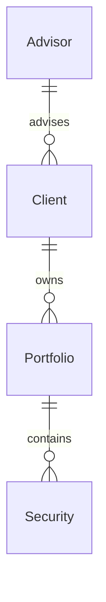

# Counselor entity model

Java/Jakarta Persistence coursework for Task 2 of the Wells Fargo software engineering program on Forage. This repository models advisors, clients, portfolios, and security holdings. It is an educational entity layer; no financial advisory workflows are implemented.

## Implemented model



The diagram reflects the actual owning-side `@ManyToOne` fields:

| Entity | Stored data | Relationship | ID generation |
|---|---|---|---|
| `Advisor` | Name, address, phone, email | Referenced by `Client.advisor` | Default `@GeneratedValue` strategy |
| `Client` | Name, address, phone, email | Required `advisorId` join | `GenerationType.IDENTITY` |
| `Portfolio` | Creation date | Required `clientId` join | `GenerationType.IDENTITY` |
| `Security` | Name, category, purchase date, price, quantity | Required `portfolioId` join | `GenerationType.IDENTITY` |

All four entities have protected no-argument constructors for JPA, public data constructors, and getters/setters. Required columns use `nullable = false`; request validation is not implemented. Parent entities do not expose inverse collections.

There is no application UI to photograph. The entity diagram visualizes the implemented layer.

## Build and inspect

The Maven wrapper is committed. Set `JAVA_HOME` to a compatible JDK; the POM targets Java 19, so the JDK must support compiling that target.

Windows PowerShell:

```powershell
.\mvnw.cmd -B verify
```

macOS/Linux:

```bash
./mvnw -B verify
```

The build produces `target/counselor-0.0.1-SNAPSHOT.jar`.

On 2026-11-07, the Windows wrapper JAR was compared by SHA-256 with the official Maven Central artifact, and `mvnw.cmd -B verify` succeeded using the installed Android Studio JDK. **No tests ran:** there is no `src/test` tree. The macOS/Linux command was not executed in that check.

## Runtime scope

`Entrypoint` starts Spring Boot but explicitly excludes `DataSourceAutoConfiguration`. Although H2 and Spring Data JPA are declared dependencies, this snapshot does not configure an active persistence layer. It has no repositories, services, controllers, migrations, authentication, or business workflows.

To start the entry point:

```powershell
.\mvnw.cmd spring-boot:run
```

Startup and HTTP behavior were not exercised by the build check. There are no project-defined HTTP endpoints to demonstrate; successful packaging does not establish a working CRUD service.

## Source map

```text
pom.xml                         Spring Boot 3.0.4, Java 19 target
.mvn/, mvnw, mvnw.cmd           Maven 3.8.7 wrapper
src/main/java/com/wellsfargo/counselor/
  Entrypoint.java               Datasource autoconfiguration excluded
  entity/
    Advisor.java
    Client.java
    Portfolio.java
    Security.java
```

The default branch is `flow`.

## Limitations and next exercises

- Add persistence integration tests before introducing repository or service behavior.
- Validate email, dates, quantities, and monetary inputs when an input boundary exists. The monetary field is currently `double`; precise decimal handling needs a deliberate model/migration change before real financial use.
- Add a persistence configuration and transactional services if extending beyond the coursework entity task.
- Review dependency support and advisories before deployment. This documentation change did not upgrade or certify the pinned Spring Boot version.

No repository-wide license is declared. The Maven wrapper retains its upstream Apache notices; those notices do not license the coursework as a whole.
